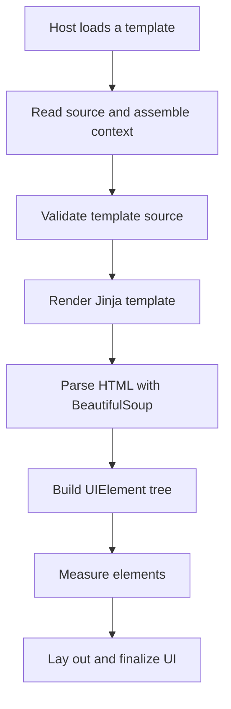

UCHTML is the client's markup engine for content-shaped panels. It renders HTML-like templates against a context a host supplies and turns the result into client UI elements.

In the Metin2 mainline engine, a window takes three hand-written artifacts: a layout, client logic, and the data interface that connects it to the game. The quest letter has a fixed set of markup tokens. The data a window shows must be copied by hand or carried through shared C++ structures and packets. UCHTML gives content a template and a data context, so changing a page does not require a new hardcoded window for every arrangement of that content.

## Templates become client UI

A host creates an `HTMLLayoutLoader`, gives it a template path and optional variables, and loads the page. The loader reads the source through `pack_open`, assembles the context, renders the template, and builds a tree of UI elements.

The context holds the loader's `fun` and `bonus` namespaces, whatever data namespaces the client registers, and the variables the host passes. Injected variables are merged last, so a host can replace a standard entry. The [template context](/docs/uchtml/jinja2-context) reference lists the names.

After Jinja renders the template, BeautifulSoup parses the resulting HTML. The loader turns that structure into its own `UIElement` tree. Measurement creates real UI objects for leaves when their size is needed; layout then assigns positions and sizes, and finalization completes the UI.

## Jinja supplies the template language

Jinja provides control flow, includes, macros, expressions, and function embedding. A page can share a fragment, select content from data, and call functions supplied through its context.

A home-made markup language needs its own parser and conditional syntax, and a strict, narrowly supported one leaves authors without the linters and tooling an established template language has. Jinja supplies those without making every content decision a new markup rule. The [Jinja reference](/docs/uchtml/jinja2) covers the syntax, and the [grid](/docs/uchtml/grid-system) and [tag](/docs/uchtml/components-common) references cover layout and elements.

## Reactive zones rebuild their children

A reactive zone limits which part of the UI tree an update rebuilds. A `div` or `body` with a parent, an `id` and a `reactive` attribute listing variable names is a zone.

When `SetVar` changes a value, the loader renders the whole template again, finds each watching zone by ID in the new result, destroys that zone's children and builds new ones. The engine has a tree differ and stores virtual trees, but this path never calls the differ. The saving is in not rebuilding the rest of the UI tree; template rendering still happens, so the cost scales with the template, not with the change.

A variable no zone watches, or a failed zone update, falls back to a full reload. The [reactive zones](/docs/uchtml/reactive-zones) reference has the rules and the batching behaviour.

## Debug and production rendering

A debug client builds a fresh Jinja environment and parses the source on every render, so edits reload. A production client with a template name uses a cached environment and a precompiled module looked up by the SHA-1 of the template name, so the source text is not parsed.

The loader still opens the original template path first, so the module does not replace the file: both ship. See [compiled templates](/docs/uchtml/compiled-templates).

The source validator runs when `ENABLE_WIKI_DEV` is set. It strips Jinja directives and expressions, checks the remaining HTML, and stops the load on errors before any UI exists. It checks the source, not every result of rendering.

## Pack first, folder second

`pack_open` checks the pack and falls back to the filesystem. A disk edit can appear to do nothing when a packed copy of the same path exists.

## Clients

A client embeds the loader in a window, configures its path resolver, and loads a template with variables. The host owns the surrounding window and the state the panel needs; UCHTML owns the rendering and the tree inside the loader. The in-game wiki, which feeds templates with generated game data, is one such client. The existing UI script loader can also construct an `html_loader` element.

## Native registrations

UCHTML exposes its surface through Python and templates. It has no native registrations.

| Native registration | Purpose |
| --- | --- |
|  |  |

## What stays hand-built

Hand-built uiscript windows remain the default for general client windows. UCHTML is the path for panels whose structure follows content: a description, a list of events, state shown to the player. A hand-built window can contain a UCHTML loader without giving up the rest of its UI.

## Runtime costs

The client runs Python 2.7 and carries vendored libraries for template and HTML parsing. Those must stay compatible with that runtime, and rendering a template and building UI elements costs client time. A Python 3 port is not on the roadmap.
