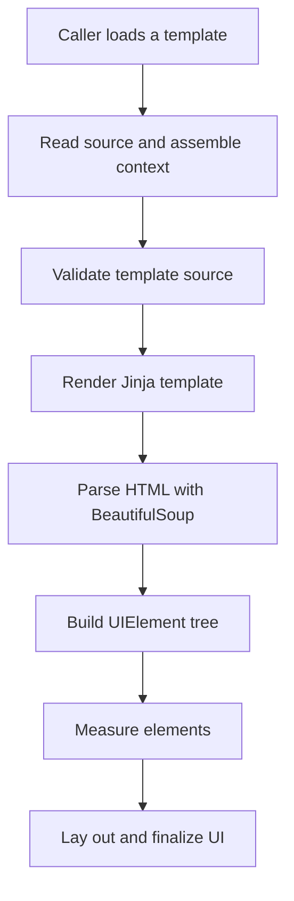

UCHTML is the client's markup engine for content-shaped panels. It renders HTML-like templates with game data and turns the result into client UI elements.

In the Metin2 mainline engine, a window takes three hand-written artifacts: a layout, client logic, and the data interface that connects it to the game. The quest letter has a fixed set of markup tokens. Wiki facts must be hand-copied or carried through shared C++ structures and packets. UCHTML gives content a template and a data context, so changing a page does not require a new hardcoded window for every arrangement of that content.

## Templates become client UI

A caller creates an `HTMLLayoutLoader`, supplies a template path and optional variables, and loads the page. The loader reads the source through `pack_open`, assembles the context, renders the template, and builds a tree of UI elements.

The rendering and layout passes have separate jobs:



The context includes world, item, mob, and quest data, translation helpers, functions under `fun`, and variables supplied by the caller. Injected variables are merged last, so a caller can replace a standard context entry. The [Jinja context reference](/docs/wiki/jinja2-context) describes the available names.

After Jinja renders the template, BeautifulSoup parses the resulting HTML. The loader turns that structure into its own `UIElement` tree. Measurement creates real UI objects for leaves when their actual size is needed; layout then assigns positions and sizes, and finalization completes the UI.

## Jinja supplies the template language

Jinja provides control flow, includes, macros, expressions, and function embedding. A page can share a template fragment, select content from data, and call functions supplied through its context.

A home-made markup language needs its own parser and conditional syntax. A strict, narrowly supported language also leaves authors without the linters and other tooling available for an established template language. Jinja supplies those facilities without making every content decision a new markup rule.

The [Jinja reference](/docs/wiki/jinja2) covers template syntax. The [component reference](/docs/wiki/ui-components) and [grid reference](/docs/wiki/grid-system) cover the UI elements and layout rules.

## World data supplies the facts

The `world` context exposes `world_data`; item, mob, and quest data are also available directly through their respective context entries. The client loads wiki data and configuration from the locale's `wiki` directory.

The Wiki Manager's quest interpreter reads quest script text, preprocesses reward tables, and sends the text with an analysis prompt to an OpenAI-compatible chat completion API. It parses the response as JSON. The builder reads interpreted JSON into quest objects and uses those objects alongside other game data to generate wiki data. This is LLM-assisted source analysis, rather than execution of the whole quest in a game runtime. The [data generation reference](/docs/wiki/data-generation) covers the inputs and outputs.

Item and mob extension data is merged into the generated data. Dictionaries merge recursively; other extension values replace the generated values, including lists. An extension list therefore replaces the corresponding generated list rather than adding entries to it.

## Reactive zones rebuild their children

A reactive zone limits which part of the UI tree is rebuilt when a watched variable changes. With reactive handling enabled, a `div` or `body` becomes a zone when it has a parent, a nonempty `id`, and a nonempty `reactive` attribute. The attribute holds comma-separated variable names. Use a unique ID within the loader.

When `SetVar` changes a value, the loader tries to update the zones watching it. It renders the entire template again, finds each affected zone by ID in the new result, destroys that zone's old children, and builds new children. The zone root is marked dirty and its parent is notified of the change.

The engine has a tree differ and stores virtual trees, but this update path does not call the differ or apply its patches. The saving is in rebuilding the affected zone's children instead of reloading the whole UI tree; template rendering still happens.

A changed variable with no watching zone causes a full reload. A failed zone update also falls back to a full reload, including when the zone's ID is absent from the rendered result. For batched updates, every changed key must be watched and its affected zones must support the reactive path. `reload=False` updates the context and invokes the variable callback without triggering that update. Independently watched nested zones need care because their update order is not specified.

## Template loading and validation

For reads, `pack_open` checks the pack first and falls back to the filesystem. A disk edit can therefore appear to do nothing when a packed copy of the same path is available.

In debug rendering, the engine creates a fresh Jinja environment and parses the supplied source, allowing hot reload. Outside debug mode, when the loader has a template name, it uses a cached environment and a precompiled template. The Wiki Manager compiler collects `.html` and `.jinja` templates under the configured wiki path and writes Python template modules under `wiki/tmpl`.

The loader still opens the original template path before choosing the rendering branch. A compiled module alone does not satisfy that initial source read. The cached compiled environment also retains the path resolver with which it was created.

The source validator runs in every build through `ENABLE_WIKI_DEV`. It removes Jinja directives and expressions before checking the remaining HTML, and uses placeholder tags for macro boundaries. Validation errors stop the load before the UI tree is built and log:

```text
HTML Validation Errors in template source:
```

That check validates the preprocessed source. It does not prove that every result of Jinja rendering will produce the intended UI.

## Content panels embed the loader

The wiki, dungeon state, events, item shop, master hunt, and patch notes embed UCHTML. A host can instantiate `HTMLLayoutLoader` in a window, configure its path resolver, and load a template with variables. The existing UI script loader can also construct an `html_loader` element.

The host still owns the surrounding window and supplies the state the panel needs. UCHTML owns the template rendering and the UI tree inside its loader. The [wiki quickstart](/docs/wiki/quickstart) covers page setup, and the [configuration reference](/docs/wiki/configuration) covers wiki configuration.

## Native registrations

UCHTML exposes its surface through Python and templates. It has no native registrations.

| Native registration | Purpose |
| --- | --- |
|  |  |

## What stays hand-built

Hand-built uiscript windows remain the default path for general client windows. UCHTML is a path for panels whose structure follows content: a description, a wiki page, a list of events, or state presented to the player. A conventional window can contain an UCHTML loader without giving up the rest of its hand-built UI.

The conventional UI workflow calls for a uiscript layout, Python logic, and a wire schema. Counts of HTML files and UI source files do not measure how many windows use each path, so they do not establish a percentage of the UI built with UCHTML.

## Runtime costs

The client runs Python 2.7 and carries vendored libraries for the template and HTML parsing work. Those dependencies have to remain compatible with the client's runtime, and rendering a template and constructing UI elements have a cost on the client.

A Python 3 port is not on the roadmap.
